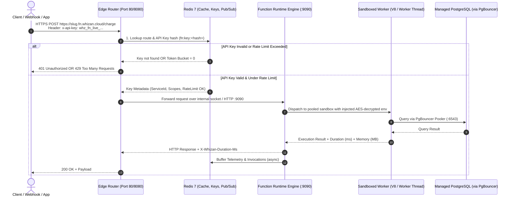
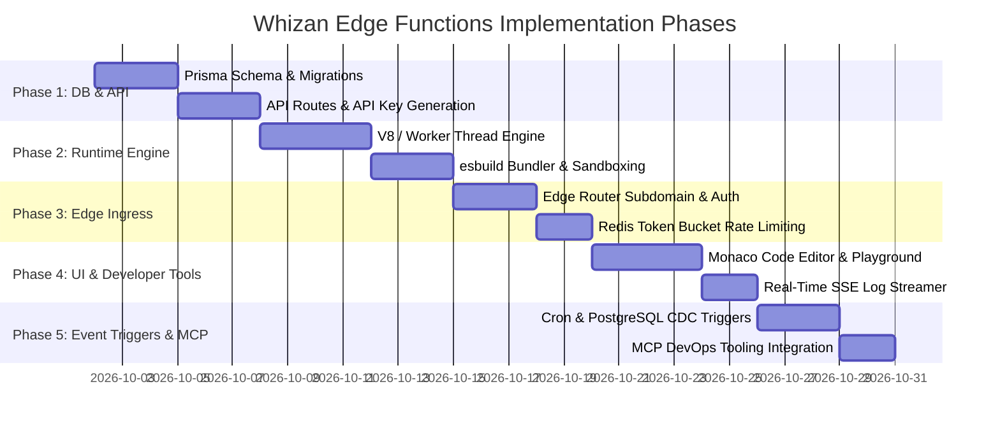

# Whizan Edge Functions — Technical Architecture & Low-Level Design (LLD)

> **Document Status:** Architectural Specification & Implementation Blueprint  
> **System Scope:** Edge Functions Subsystem (`@whizan/function-runtime`, `apps/edge-router`, `apps/api`, `apps/build-worker`, `packages/db`)  
> **Target Platform:** Node.js 20+, TypeScript, V8 Isolates, Docker, Redis 7+, PostgreSQL 16 (PgBouncer), Azure Linux VM (2 vCPU / 4 GB RAM)

---

## 🏗️ 1. Architectural Philosophy & System Topology

The Whizan Edge Function subsystem is designed to deliver **ultra-low latency**, **instant scale-to-zero**, and **robust multi-tenant isolation** on constrained host infrastructure (e.g. 2 vCPU / 4 GB RAM).

Unlike traditional long-running containers (which require separate network ports, 150MB+ base RAM, and 1–3s cold starts), Whizan Edge Functions utilize a **high-density, dual-tier execution model**:
1. **Tier 1 (Edge Standard — V8 / Worker Pool):** TypeScript and JavaScript functions executing inside lightweight isolated sandboxes. Startup time is **< 5ms**, baseline memory is **~8–15MB**, and hundreds of concurrent invocations can run on a single host without port exhaustion.
2. **Tier 2 (Polyglot Micro-Workers):** Python 3.11 and Go 1.22 functions running in a pre-warmed, ephemeral container snapshot pool with scale-to-zero after 60s of idle time.

### End-to-End System Flow Diagram



---

## ⚙️ 2. Core Infrastructure Decisions for Maximum Efficiency

| Architectural Dimension | Traditional Cloud Run / Docker | Whizan Edge Function Architecture | Rationale & Performance Impact |
| :--- | :--- | :--- | :--- |
| **Cold Start Latency** | 1,200ms – 3,500ms (Container boot, network attach) | **< 5ms (V8 / Worker Thread)**<br/>**< 150ms (Pre-warmed Polyglot)** | Code bundles are pre-compiled into single-file ESM artifacts via `esbuild`. Re-usable thread pools eliminate Docker daemon overhead. |
| **Memory per Function** | 150MB – 300MB RAM minimum | **8MB – 15MB RAM per sandbox** | Allows up to **200+ concurrent function sandboxes** on our 4GB Azure VM without triggering the Linux OOM Killer. |
| **Port Allocation** | Consumes 1 TCP host port per container | **0 Host Ports (Unix Domain Socket / Single Gateway Port 9090)** | Eliminates port exhaustion (ephemeral port limits) and avoids Docker iptables bridge saturation. |
| **Routing Lookup** | Database query on every request | **Sub-millisecond Redis LRU Cache (`fn:key:<hash>`, `fn:route:<slug>`)** | Edge Router validates authentication and resolves target handlers in < 0.8ms without touching PostgreSQL. |
| **Database Connections** | N functions = N database connections (Postgres crashes) | **All functions route through built-in PgBouncer pooler** | Safely multiplexes thousands of ephemeral function queries into 10–20 persistent PostgreSQL connections. |

---

## 🗄️ 3. Database Schema Extensions (`packages/db/prisma/schema.prisma`)

To preserve strict separation of concerns, the Edge Functions subsystem uses dedicated models prefixed with `Function`:

```prisma
// ─────────────────────────────────────────
//  FUNCTION SERVICES (Serverless Backend)
// ─────────────────────────────────────────
model FunctionService {
  id             String            @id @default(uuid())
  userId         String            @map("user_id")
  name           String
  slug           String            @unique // e.g. "payment-api" -> payment-api.fn.whizan.cloud
  runtime        FunctionRuntime   @default(EDGE_TYPESCRIPT)
  entryFile      String            @default("index.ts") @map("entry_file")
  timeoutMs      Int               @default(10000) @map("timeout_ms") // Max execution limit in ms (default 10s)
  memoryLimit    Int               @default(128) @map("memory_limit") // RAM limit in MB (128, 256, 512, 1024)
  minInstances   Int               @default(0) @map("min_instances")   // 0 = scale-to-zero, 1+ = always warm
  maxConcurrency Int               @default(10) @map("max_concurrency") // Concurrent requests per worker
  isPublic       Boolean           @default(false) @map("is_public")   // If true, bypasses API key check
  corsOrigins    String[]          @default(["*"]) @map("cors_origins")
  createdAt      DateTime          @default(now()) @map("created_at")
  updatedAt      DateTime          @updatedAt @map("updated_at")

  user           User              @relation(fields: [userId], references: [id], onDelete: Cascade)
  apiKeys        FunctionApiKey[]
  endpoints      FunctionEndpoint[]
  deployments    FunctionDeployment[]
  envVariables   FunctionEnvVariable[]
  triggers       FunctionTrigger[]
  invocations    FunctionInvocation[]

  @@map("function_services")
}

enum FunctionRuntime {
  EDGE_TYPESCRIPT // V8 / Worker Thread Web Standards runtime
  NODEJS_20       // Node.js 20 with full npm package support
  PYTHON_311      // Python 3.11 micro-runner
  GOLANG_122      // Compiled Go micro-binary

  @@map("function_runtime")
}

// ─────────────────────────────────────────
//  FUNCTION API KEYS (Authentication & Rate Limiting)
// ─────────────────────────────────────────
model FunctionApiKey {
  id           String      @id @default(uuid())
  serviceId    String      @map("service_id")
  name         String      @default("Production Key")
  keyHash      String      @unique @map("key_hash") // SHA-256 of full plaintext key
  keyPrefix    String      @map("key_prefix")       // e.g. "whz_fn_live_a1b2..."
  scopes       String[]    @default(["EXECUTE"])    // EXECUTE | READ_LOGS | ADMIN
  rateLimitRpm Int         @default(600) @map("rate_limit_rpm") // Requests per minute
  ipWhitelist  String[]    @default([]) @map("ip_whitelist")    // Optional allowed CIDRs
  expiresAt    DateTime?   @map("expires_at")
  lastUsedAt   DateTime?   @map("last_used_at")
  createdAt    DateTime    @default(now()) @map("created_at")

  service      FunctionService @relation(fields: [serviceId], references: [id], onDelete: Cascade)

  @@index([serviceId])
  @@map("function_api_keys")
}

// ─────────────────────────────────────────
//  FUNCTION ENDPOINTS (Individual Route Handlers)
// ─────────────────────────────────────────
model FunctionEndpoint {
  id           String          @id @default(uuid())
  serviceId    String          @map("service_id")
  name         String          // e.g. "charge" or "webhook"
  routePath    String          @map("route_path") // e.g. "/charge", "/users/:id"
  httpMethods  String[]        @default(["GET", "POST"]) @map("http_methods")
  handlerName  String          @default("default") @map("handler_name") // Exported function name in code
  isPublic     Boolean         @default(false) @map("is_public")
  cacheTtlSec  Int             @default(0) @map("cache_ttl_sec") // 0 = no cache, >0 = Edge Redis cache
  createdAt    DateTime        @default(now()) @map("created_at")

  service      FunctionService @relation(fields: [serviceId], references: [id], onDelete: Cascade)

  @@unique([serviceId, routePath])
  @@map("function_endpoints")
}

// ─────────────────────────────────────────
//  FUNCTION DEPLOYMENTS (Code Bundles & Versions)
// ─────────────────────────────────────────
model FunctionDeployment {
  id              String           @id @default(uuid())
  serviceId       String           @map("service_id")
  version         Int              @default(1)
  bundlePath      String           @map("bundle_path") // Disk path to compiled ESM bundle (/opt/whizan/functions/...)
  bundleHash      String           @map("bundle_hash") // SHA-256 integrity hash
  bundleSizeBytes Int              @map("bundle_size_bytes")
  status          DeploymentStatus @default(READY)
  trafficWeight   Int              @default(100) @map("traffic_weight") // 100% active, or canary (e.g. 10%)
  errorMessage    String?          @map("error_message")
  createdAt       DateTime         @default(now()) @map("created_at")

  service         FunctionService  @relation(fields: [serviceId], references: [id], onDelete: Cascade)

  @@index([serviceId, createdAt(sort: Desc)])
  @@map("function_deployments")
}

// ─────────────────────────────────────────
//  FUNCTION TRIGGERS (Event Triggers: Cron, DB, Queue)
// ─────────────────────────────────────────
model FunctionTrigger {
  id          String      @id @default(uuid())
  serviceId   String      @map("service_id")
  type        TriggerType @default(HTTP)
  config      Json        // Cron expression, DB table name, Queue name, etc.
  enabled     Boolean     @default(true)
  lastRunAt   DateTime?   @map("last_run_at")
  createdAt   DateTime    @default(now()) @map("created_at")

  service     FunctionService @relation(fields: [serviceId], references: [id], onDelete: Cascade)

  @@map("function_triggers")
}

enum TriggerType {
  HTTP
  CRON
  DATABASE_CDC
  STORAGE_BLOB
  QUEUE_MESSAGE

  @@map("trigger_type")
}

// ─────────────────────────────────────────
//  FUNCTION ENV VARIABLES (Encrypted Secrets)
// ─────────────────────────────────────────
model FunctionEnvVariable {
  id        String          @id @default(uuid())
  serviceId String          @map("service_id")
  key       String
  value     String          // AES-256-GCM encrypted ciphertext (iv:tag:cipher)
  isSecret  Boolean         @default(true) @map("is_secret")
  createdAt DateTime        @default(now()) @map("created_at")

  service   FunctionService @relation(fields: [serviceId], references: [id], onDelete: Cascade)

  @@unique([serviceId, key])
  @@map("function_env_variables")
}

// ─────────────────────────────────────────
//  FUNCTION INVOCATIONS (Buffered Telemetry)
// ─────────────────────────────────────────
model FunctionInvocation {
  id          String   @id @default(uuid())
  serviceId   String   @map("service_id")
  endpoint    String
  httpMethod  String   @map("http_method")
  statusCode  Int      @map("status_code")
  durationMs  Float    @map("duration_ms")
  memoryMb    Float    @map("memory_mb")
  clientIp    String   @map("client_ip")
  timestamp   DateTime @default(now())

  service     FunctionService @relation(fields: [serviceId], references: [id], onDelete: Cascade)

  @@index([serviceId, timestamp(sort: Desc)])
  @@map("function_invocations")
}
```

---

## 🔐 4. API Key Architecture & Authentication Pipeline

Every Function Service receives its own isolated API key store. Unlike generic user tokens, Function API Keys are optimized for high-throughput, edge-evaluated authorization:

### 1. Key Format & Cryptography
```text
Prefix: whz_fn_live_ | whz_fn_test_
Secret: 32 cryptographically secure random bytes (64 hex characters)
Example: whz_fn_live_7e8b9f0a1c2d3e4f5a6b7c8d9e0f1a2b3c4d5e6f7a8b9c0d1e2f3a4b5c6d7e8f
```
- The database stores **only** the SHA-256 hash (`keyHash`).
- The user is displayed the full plaintext key **only once** upon creation.
- A truncated prefix (`keyPrefix`, e.g. `whz_fn_live_7e8b9f...`) is displayed for identification in the dashboard.

### 2. High-Speed Sub-Millisecond Redis Authentication Cache
When an incoming request reaches the Edge Router:
1. The Edge Router extracts the key from one of three supported transports:
   - Header: `x-api-key: whz_fn_live_...` (Standard)
   - Header: `Authorization: Bearer whz_fn_live_...` (Standard)
   - Query Param: `?apiKey=whz_fn_live_...` (Webhook / Browser fallback)
2. Edge Router hashes the key using SHA-256.
3. Edge Router checks Redis key: `fn:key:<keyHash>`:
   ```json
   {
     "serviceId": "f47ac10b-58cc-4372-a567-0e02b2c3d479",
     "slug": "payment-api",
     "scopes": ["EXECUTE"],
     "rateLimitRpm": 600,
     "ipWhitelist": ["192.168.1.0/24"],
     "expiresAt": null
   }
   ```
4. **Cache Miss / Hydration:** If the key is not in Redis, the Edge Router queries PostgreSQL via Prisma, validates the key, caches it in Redis with an 8-hour TTL, and records the `lastUsedAt` timestamp asynchronously.
5. **Token Bucket Rate Limiting:** Evaluated directly in Redis via an atomic Lua script:
   - Key: `fn:ratelimit:<keyHash>:<minuteWindow>`
   - Increments counter with 60s TTL; if counter > `rateLimitRpm`, immediately returns HTTP 429 (`Retry-After: 30`).

---

## 🌐 5. Edge Router Ingress & Request Dispatching

The Edge Router (`apps/edge-router/src/index.ts`) intercepts wildcard function domains:
- Format: `<slug>.fn.whizan.cloud`
- Path-based alternative: `whizan.cloud/fn/<slug>/<path>`

### Route Resolution Pipeline

```
Incoming Request
      │
      ▼
Is Host *.fn.<BASE_DOMAIN>? ──► Yes ──► Extract slug from Host
      │ No
      ▼
Is Path /fn/<slug>/*?       ──► Yes ──► Extract slug from Path
      │ No
      ▼
Normal Static / SSR / Service Routing
      │
      ▼ (For Edge Functions)
1. Query Redis: fn:service:<slug>
2. If service.isPublic == false:
      Verify x-api-key against fn:key:<hash>
3. Check Edge Cache (if endpoint.cacheTtlSec > 0):
      Return cached payload if HIT
4. Proxy to Function Runtime Engine (Unix Socket or http://127.0.0.1:9090/invoke)
5. Receive Response + Execution Headers (X-Whizan-Duration-Ms)
6. Asynchronously append invocation telemetry to analytics:buffer
7. Return payload to client
```

---

## ⚡ 6. The Execution Engine (`Whizan Function Runtime`)

The execution engine is implemented as a dedicated, hyper-efficient Node.js microservice (`packages/function-runtime` or `apps/function-runtime`) listening on internal port `9090` or Unix domain socket `/tmp/whizan-function-runtime.sock`.

### 1. Code Bundling Phase (`esbuild`)
When code is deployed (via dashboard or Git/CLI), the Build Worker bundles the code using `esbuild`:
```typescript
import * as esbuild from "esbuild";

await esbuild.build({
  entryPoints: [userEntryPath],
  bundle: true,
  format: "esm",
  platform: "neutral",
  target: "es2022",
  outfile: bundleOutputPath,
  minify: true,
  treeShaking: true,
  external: ["node:*"], // Externalize standard library
});
```

### 2. Sandbox Execution Model (V8 Isolated Context / Worker Thread)
For each invocation, the engine executes the compiled ESM handler:

```typescript
// Standard Web Handler Interface (matches Cloudflare Workers / Supabase Edge Functions)
export default async function handler(request: Request, context: FunctionContext): Promise<Response> {
  const { amount, currency } = await request.json();
  return Response.json({ status: "success", chargeId: "ch_123" });
}
```

#### Execution Sandbox Architecture:
1. **Worker Pool (Pre-warmed):** The runtime maintains a pool of 4–8 pre-warmed worker execution threads.
2. **Context Injection:**
   - Standard Web APIs: `Request`, `Response`, `Headers`, `fetch`, `crypto`, `URL`, `TransformStream`, `ReadableStream`, `TextEncoder`, `TextDecoder`, `console`.
   - Injected Context: `context.env` (decrypted AES-256-GCM secrets), `context.waitUntil()`, `context.params` (parsed route parameters).
3. **Hard Timeout Enforcement:**
   ```typescript
   const controller = new AbortController();
   const timer = setTimeout(() => controller.abort(), service.timeoutMs);
   try {
     const res = await Promise.race([
       userHandler(webRequest, { env: decryptedEnv, signal: controller.signal }),
       new Promise((_, reject) =>
         setTimeout(() => reject(new Error("FUNCTION_TIMEOUT")), service.timeoutMs)
       ),
     ]);
     return res;
   } finally {
     clearTimeout(timer);
   }
   ```
4. **Memory Hard Limit:** Monitored via `v8.getHeapStatistics()` per isolate; if heap exceeds `memoryLimit` (e.g. 128MB), the sandbox is forcefully recycled and an HTTP 500 (`MEMORY_LIMIT_EXCEEDED`) is returned.

---

## ⏰ 7. Event Triggers Subsystem (Firebase Parity)

### 1. Cron / Scheduled Triggers
- Built into the `apps/build-worker` scheduler using BullMQ repeatable jobs.
- Reads `FunctionTrigger` where `type: CRON`.
- When the cron fires (e.g. every midnight `0 0 * * *`), BullMQ dispatches an internal synthetic HTTP request directly to the function runtime:
  ```http
  POST /invoke/payment-api/nightly-cleanup
  X-Whizan-Trigger: CRON
  X-Whizan-Internal-Secret: <cluster-secret>
  ```

### 2. Database CDC Triggers (PostgreSQL LISTEN / NOTIFY)
- Connects directly to Whizan Database Services.
- A lightweight daemon in `apps/api` listens on a PostgreSQL notification channel (`whizan_cdc_events`).
- On database `INSERT`, `UPDATE`, or `DELETE`, a database trigger fires `pg_notify('whizan_cdc_events', payload)`.
- The daemon catches the payload and invokes the configured function asynchronously with the row data:
  ```json
  {
    "event": "INSERT",
    "table": "orders",
    "record": { "id": 101, "total": 4900, "status": "paid" },
    "oldRecord": null
  }
  ```

---

## 🛡️ 8. Edge Cases, Failure Handling & Resilience Matrix

| Edge Case / Failure Mode | Root Cause | System Defense & Mitigation | User / Client Impact |
| :--- | :--- | :--- | :--- |
| **Runaway Infinite Loop** | User writes `while(true) {}` | `AbortController` signal + hard thread termination precisely at `timeoutMs`. | Client receives `504 Gateway Timeout` in exact timeout ms. VM CPU remains unaffected. |
| **Out-of-Memory (OOM)** | Memory leak, giant array in RAM | V8 heap limit allocation caps + sandbox disposal. | Function returns `500 Memory Limit Exceeded`. Neighboring functions unaffected. |
| **Database Connection Exhaustion** | 500 functions query Postgres simultaneously | All functions automatically receive `DATABASE_URL` pointing to **PgBouncer** (:6543) instead of direct Postgres. | Connections are multiplexed; queries queue smoothly without Postgres crashing. |
| **API Key Compromise** | Developer accidentally commits key to GitHub | One-click revocation in dashboard; immediate Redis cache purge across all edge nodes (< 1s). | Stolen key returns `401 Unauthorized` instantly. |
| **Traffic Spike / DDoS** | Spurt of 10,000 req/sec | Edge Router token-bucket rate limiter rejects excess requests at reverse-proxy boundary. | Extra requests receive `429 Too Many Requests`. Runtime compute preserved. |
| **Secrets Exposure in Logs** | User code does `console.log(process.env)` | Log streamer runs regex filter against all decrypted environment variable values, replacing them with `[REDACTED]`. | Sensitive keys never appear in dashboard SSE stream or Redis log history. |

---

## 🗺️ 9. Phased Implementation Roadmap



### Detailed Phase Tasks:
- **Phase 1: Database & Control Plane (`packages/db`, `apps/api`)**
  - Add Prisma models: `FunctionService`, `FunctionApiKey`, `FunctionEndpoint`, `FunctionDeployment`, `FunctionTrigger`, `FunctionInvocation`.
  - Add routes: `POST /api/functions`, `GET /api/functions`, `POST /api/functions/:id/keys`, `POST /api/functions/:id/deploy`.
- **Phase 2: Execution Engine (`packages/function-runtime`)**
  - Implement worker pool with Web Standard `Request` and `Response` interfaces.
  - Implement `esbuild` fast bundler in `apps/build-worker`.
  - Implement hard execution timeout and memory cap enforcement.
- **Phase 3: Edge Routing & High-Speed Ingress (`apps/edge-router`)**
  - Add `*.fn.<BASE_DOMAIN>` and `/fn/<slug>` route handling.
  - Implement sub-millisecond Redis key validation and token-bucket rate limiter.
  - Add response caching for idempotent endpoints (`cacheTtlSec`).
- **Phase 4: Dashboard Experience (`apps/dashboard`)**
  - Add `/dashboard/functions` management page.
  - Integrate Monaco code editor for in-browser editing.
  - Build interactive API test playground with custom headers and JSON body input.
  - Wire up real-time SSE log viewer for `console.log()` streaming.
- **Phase 5: Event Triggers & Tooling (`@whizan/mcp-devops`)**
  - Implement Cron scheduler using BullMQ repeatable jobs.
  - Implement PostgreSQL CDC listener (`LISTEN/NOTIFY`).
  - Add MCP tools: `whizan_create_function`, `whizan_deploy_function`, `whizan_invoke_function`.

---

## 📚 10. Related Architecture Documentation

- Non-Technical Overview: [`docs/edge_functions_non_technical.md`](file:///Users/ayushjaiswal/Desktop/Hosting%20copy/docs/edge_functions_non_technical.md)
- Backend Architecture Guide: [`docs/backend_architecture.md`](file:///Users/ayushjaiswal/Desktop/Hosting%20copy/docs/backend_architecture.md)
- Core Monorepo Reference: [`docs/codebase_documentation.md`](file:///Users/ayushjaiswal/Desktop/Hosting%20copy/docs/codebase_documentation.md)
- Service Mesh & Networking: [`docs/backend_progress/service_mesh_and_discovery_catalog.md`](file:///Users/ayushjaiswal/Desktop/Hosting%20copy/docs/backend_progress/service_mesh_and_discovery_catalog.md)
