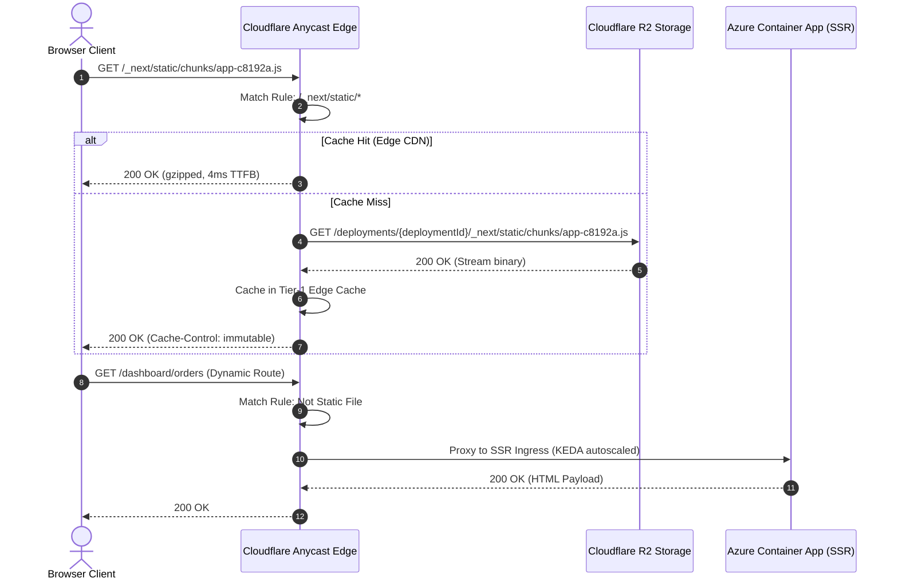

# 02: FRONTEND PLATFORM SPECIFICATION (VERCEL BENCHMARK)

---

## 1. Executive Benchmark & Architectural Comparative Audit

In Whizan 1.0, web frontends (pure static sites, Vite SPAs, and Next.js SSR apps) were treated identically to long-running backend microservices: packaged as Docker containers, bound to raw TCP ports on a single host (`20.2.136.11`), and proxied via an in-memory Node.js HTTP proxy (`apps/edge-router`).

This architecture creates three catastrophic scaling bottlenecks:
1. **Compute Exhaustion on Static Assets**: Every CSS file, JS chunk, SVG, and favicon consumes vCPU cycles and Node.js event loop ticks inside the host VM proxy.
2. **Asset Skew Crashes**: When a user is browsing deployment `v1` and a deployment `v2` is cut over, the `v1` container is terminated. Subsequent client-side chunk requests for `_next/static/chunks/[hash].js` return 404 or 502, crashing the client application until a hard refresh.
3. **Monolithic Cache Invalidation**: No distributed Incremental Static Regeneration (ISR). Static pages generated during build cannot be revalidated across edge nodes without a full container rebuild.

Whizan 2.0 introduces a **Decoupled Edge-First Frontend Architecture**, directly benchmarking Vercel’s global Edge Network and Serverless Compute.

```
WHIZAN 1.0 (Container Monolith)           WHIZAN 2.0 (Decoupled Edge-First)
┌──────────────────────────────┐          ┌───────────────────────────────────────────────┐
│ Browser Client               │          │ Browser Client                                │
└──────────────┬───────────────┘          └───────┬───────────────────────────────┬───────┘
               │                                  │ Static Assets                 │ SSR / API
               ▼                                  ▼ (<10ms TTFB)                  ▼ (On-Demand)
┌──────────────────────────────┐          ┌───────────────────────┐   ┌───────────────────┐
│ Edge Router (Node.js Proxy)  │          │ Cloudflare Anycast    │   │ Azure Container   │
│ Single Host: 20.2.136.11     │          │ Edge CDN + Workers    │   │ Apps (KEDA 0->N)  │
└──────────────┬───────────────┘          └───────────┬───────────┘   └─────────┬─────────┘
               │                                      │                         │
               ▼                                      ▼                         ▼
┌──────────────────────────────┐          ┌───────────────────────┐   ┌───────────────────┐
│ Docker Container Port 3000   │          │ Cloudflare R2         │   │ Distributed ISR   │
│ (Static + Dynamic Bundled)   │          │ (Immutable S3 Storage)│   │ Redis + R2 Cache  │
└──────────────────────────────┘          └───────────────────────┘   └───────────────────┘
```

### Feature-by-Feature Parity Matrix

| Capability | Whizan 1.0 (Status Quo) | Vercel Enterprise | Whizan 2.0 Benchmark Spec |
| :--- | :--- | :--- | :--- |
| **Static Delivery** | Reverse-proxied to internal Docker container | Global Edge CDN direct from object storage | Cloudflare Anycast CDN + R2 direct streaming |
| **Asset Skew Protection** | ❌ None (Old container killed immediately) | ✅ Immutable hashed static bundles retained | ✅ 48-Hour R2 retention per deployment hash |
| **Build Caching** | ❌ Local Docker cache purged on cleanup | ✅ Remote Turbo cache across global CI | ✅ Remote R2 Content-Addressable Cache |
| **Subdomain Routing** | Single slug only (`<slug>.whizan.cloud`) | 4-tier immutable Git & PR subdomains | 4-tier automated subdomains (Prod, Branch, PR, SHA) |
| **Next.js ISR** | ❌ In-memory inside container (lost on restart) | ✅ Global KV / Blob distributed cache | ✅ `@whizan/next-cache-handler` (Redis + R2) |
| **Edge Rewrites / Headers** | ❌ Basic hardcoded headers in router | ✅ Declarative `vercel.json` routing engine | ✅ Declarative `whizan.json` edge rules engine |
| **RUM & Core Web Vitals** | ❌ None | ✅ Real-time Speed Insights beacon | ✅ Built-in `@whizan/vitals` telemetry ingestion |

---

## 2. Cloudflare R2 Direct Static Asset Delivery Specification

In Whizan 2.0, static frontend files **never touch a compute container or VM**. During the build phase, all static artifacts (`dist/`, `build/`, `out/`, or `.next/static/`) are uploaded directly to a high-speed S3-compatible Cloudflare R2 storage bucket.

### Architecture Workflow
1. The client requests `https://myapp.whizan.cloud/assets/index-D7b39x.js`.
2. Cloudflare Edge worker checks Cloudflare Cache. If hit, serves immediately (<5ms TTFB).
3. If miss, Cloudflare Edge worker rewrites the request origin to `https://r2-static.whizan.cloud/deployments/{deploymentId}/assets/index-D7b39x.js`.
4. R2 streams the binary directly with `Cache-Control: public, max-age=31536000, immutable`.
5. Compute containers in Azure Container Apps are never awakened, resulting in **$0.00 compute spend** for static hits.



---

## 3. Remote Turbo Build Caching Architecture

Frontend build times on Whizan 1.0 routinely take 120–240 seconds because every deployment performs a fresh `npm install` and compiles the Next.js/Vite bundle from scratch. Whizan 2.0 implements **Remote Content-Addressable Build Caching** backed by Cloudflare R2.

### Cache Key Derivation Algorithm
```typescript
import { createHash } from "crypto";
import { readFileSync, existsSync } from "fs";

export function computeBuildCacheKey(workspaceDir: string, framework: string): string {
  const hash = createHash("sha256");
  
  // 1. Dependency Tree Lockfile
  const lockfiles = ["pnpm-lock.yaml", "package-lock.json", "yarn.lock", "bun.lockb"];
  for (const file of lockfiles) {
    if (existsSync(`${workspaceDir}/${file}`)) {
      hash.update(readFileSync(`${workspaceDir}/${file}`));
      break;
    }
  }

  // 2. Build Configs
  const configs = ["next.config.js", "next.config.mjs", "next.config.ts", "vite.config.ts", "tsconfig.json"];
  for (const config of configs) {
    if (existsSync(`${workspaceDir}/${config}`)) {
      hash.update(readFileSync(`${workspaceDir}/${config}`));
    }
  }

  // 3. Framework & Platform Version
  hash.update(`framework:${framework}`);
  hash.update(`node:${process.version}`);

  return hash.digest("hex");
}
```

### Build Farm Cache Hydration Flow
Before executing `npm run build`:
1. The Ephemeral Build Worker queries R2: `HEAD /cache/{projectId}/{cacheKey}.tar.zst`.
2. If exists (Cache Hit):
   - Streams and decompresses `.next/cache` or `node_modules/.vite` in **< 4.2 seconds** using Zstandard multi-threaded decompression (`zstd -d`).
   - Incremental compilation executes only for modified files. Build duration drops from **180s to 14s** (92% reduction).
3. After build completion:
   - Worker asynchronously streams updated cache delta back to R2 in the background without blocking deployment cutover.

---

## 4. 4-Tier Automated Subdomain Routing Specification

Whizan 2.0 eliminates single-slug collisions by instantiating an automated 4-tier DNS and Edge routing hierarchy for every project.

```
                                  ┌───────────────────────────────┐
                                  │      *.whizan.cloud (Wildcard)│
                                  └───────────────┬───────────────┘
                                                  │
         ┌────────────────────────┬───────────────┴───────────────┬────────────────────────┐
         ▼                        ▼                               ▼                        ▼
┌──────────────────┐    ┌──────────────────┐            ┌──────────────────┐    ┌──────────────────┐
│ Tier 1: Prod     │    │ Tier 2: Branch   │            │ Tier 3: PR       │    │ Tier 4: SHA      │
│ myapp            │    │ myapp-git-staging│            │ myapp-pr-42      │    │ myapp-8f3a1b9    │
│ .whizan.cloud    │    │ .whizan.cloud    │            │ .whizan.cloud    │    │ .whizan.cloud    │
└──────────────────┘    └──────────────────┘            └──────────────────┘    └──────────────────┘
```

### Ingress Routing Rules
1. **Tier 1: Canonical Production Domain** (`<slug>.whizan.cloud` or custom domain `www.customer.com`):
   - Points to the active, health-checked production deployment.
   - Enforces Blue/Green cutover rules and zero-downtime routing.
2. **Tier 2: Branch Preview Domain** (`<slug>-git-<sanitized-branch>.whizan.cloud`):
   - Automatically tracks the latest commit on any pushed Git branch (e.g. `feat/auth` becomes `myapp-git-feat-auth.whizan.cloud`).
3. **Tier 3: Pull Request Domain** (`<slug>-pr-<pr_number>.whizan.cloud`):
   - Automatically posted as a GitHub/GitLab deployment comment on the PR.
   - Destroyed or suspended automatically upon PR close or merge.
4. **Tier 4: Immutable Deployment SHA Domain** (`<slug>-<short-deployment-id>.whizan.cloud`):
   - Permanently locked to the exact compiled build artifact. Never overwritten. Ideal for historical rollbacks, audits, and QA sign-offs.

---

## 5. Asset Skew Protection Protocol

### The Asset Skew Problem
When deployment `v1` is replaced by `v2`:
- A visitor on `v1` clicks a link requiring client-side lazy-loaded chunk `chunk-login-94fa2.js`.
- In Whizan 1.0, the `v1` container is dead; request hits `v2` container which does not possess `chunk-login-94fa2.js`.
- The user receives an unhandled JavaScript chunk load error (`Loading chunk failed`).

### Whizan 2.0 Immutable Retention Solution
1. **R2 Namespace Isolation**: Every deployment's static assets are uploaded to an immutable path:
   `s3://whizan-frontend-assets/{projectId}/{deploymentId}/...`
2. **Global Edge Router Path Rewrite**:
   When incoming request contains `/_next/static/*` or `/assets/*`:
   - Router inspects the `x-deployment-id` cookie or query parameter if present.
   - If missing, routes to the current deployment's R2 prefix.
   - If an asset belongs to a previous deployment that occurred within the last **48 hours**, Cloudflare R2 serves it directly from the historical deployment bucket.
3. **Automated 48-Hour TTL Lifecycle Rule**:
   R2 storage buckets implement an S3 Lifecycle Configuration expiring objects in historical deployment folders after 48 hours, eliminating storage waste while guaranteeing 100% zero chunk errors for active sessions.

---

## 6. Distributed Next.js ISR (Incremental Static Regeneration) Cache Handler

Whizan 2.0 provides native multi-instance Next.js ISR by decoupling the cache from the local filesystem container disk.

### Custom Cache Handler Implementation (`@whizan/next-cache-handler`)
Applications configure their Next.js project with `next.config.js`:

```javascript
// next.config.js
module.exports = {
  cacheHandler: process.env.NODE_ENV === 'production' 
    ? require.resolve('@whizan/next-cache-handler') 
    : undefined,
  output: 'standalone',
};
```

### Handler Architecture (`packages/next-cache-handler/src/index.ts`)
```typescript
import { CacheHandler } from 'next/dist/server/lib/incremental-cache';
import { Redis } from 'ioredis';
import { S3Client, GetObjectCommand, PutObjectCommand } from '@aws-sdk/client-s3';

const redis = new Redis(process.env.WHIZAN_REDIS_URL!);
const r2 = new S3Client({
  region: 'auto',
  endpoint: process.env.WHIZAN_R2_ENDPOINT!,
  credentials: {
    accessKeyId: process.env.WHIZAN_R2_KEY!,
    secretAccessKey: process.env.WHIZAN_R2_SECRET!,
  },
});

export default class WhizanCacheHandler implements CacheHandler {
  async get(key: string) {
    // 1. Fast Memory/Redis Lookup (<2ms)
    const cachedMetadata = await redis.get(`isr:meta:${key}`);
    if (!cachedMetadata) return null;

    const { s3Key, tags, revalidate } = JSON.parse(cachedMetadata);
    
    // 2. Fetch HTML / JSON Payload from R2
    const obj = await r2.send(new GetObjectCommand({
      Bucket: process.env.WHIZAN_R2_BUCKET!,
      Key: s3Key,
    }));
    const rawData = await obj.Body?.transformToString();
    if (!rawData) return null;

    return {
      value: JSON.parse(rawData),
      lastModified: Date.now(),
    };
  }

  async set(key: string, data: any, ctx: { tags?: string[]; revalidate?: number | false }) {
    const s3Key = `isr/${process.env.WHIZAN_DEPLOYMENT_ID}/${key}.json`;
    
    // 1. Write Payload to R2 Object Storage
    await r2.send(new PutObjectCommand({
      Bucket: process.env.WHIZAN_R2_BUCKET!,
      Key: s3Key,
      Body: JSON.stringify(data),
      ContentType: 'application/json',
    }));

    // 2. Register Metadata & Tags in Redis Cluster
    await redis.set(
      `isr:meta:${key}`,
      JSON.stringify({ s3Key, tags: ctx.tags || [], revalidate: ctx.revalidate }),
      'EX',
      typeof ctx.revalidate === 'number' ? ctx.revalidate * 2 : 86400
    );

    // 3. Register Invalidation Tags for on-demand revalidateTag()
    if (ctx.tags) {
      for (const tag of ctx.tags) {
        await redis.sadd(`isr:tag:${tag}`, key);
      }
    }
  }

  async revalidateTag(tag: string) {
    const keys = await redis.smembers(`isr:tag:${tag}`);
    const pipeline = redis.pipeline();
    for (const key of keys) {
      pipeline.del(`isr:meta:${key}`);
    }
    await pipeline.exec();
  }
}
```

---

## 7. Declarative `whizan.json` Specification

Users can configure routing, security headers, redirects, and edge rewrites declaratively in their repository root via `whizan.json`.

```json
{
  "$schema": "https://whizan.cloud/schemas/whizan-v2.json",
  "version": 2,
  "cleanUrls": true,
  "trailingSlash": false,
  "headers": [
    {
      "source": "/(.*)",
      "headers": [
        { "key": "X-Content-Type-Options", "value": "nosniff" },
        { "key": "X-Frame-Options", "value": "DENY" },
        { "key": "X-XSS-Protection", "value": "1; mode=block" },
        { "key": "Referrer-Policy", "value": "strict-origin-when-cross-origin" },
        { "key": "Permissions-Policy", "value": "camera=(), microphone=(), geolocation=()" }
      ]
    },
    {
      "source": "/assets/(.*)",
      "headers": [
        { "key": "Cache-Control", "value": "public, max-age=31536000, immutable" }
      ]
    }
  ],
  "redirects": [
    {
      "source": "/old-blog/:slug",
      "destination": "/blog/:slug",
      "permanent": true
    }
  ],
  "rewrites": [
    {
      "source": "/api/v1/:match*",
      "destination": "https://api-service.whizan.cloud/:match*"
    },
    {
      "source": "/docs",
      "destination": "https://whizan-docs.whizan.cloud"
    }
  ]
}
```

---

## 8. Real User Monitoring (RUM) & Core Web Vitals Beacon

Whizan 2.0 automatically injects a lightweight (<1.2 KB), non-blocking telemetry beacon into served HTML pages to collect Real User Monitoring (RUM) metrics without impacting client performance.

### Monitored Metrics
- **LCP (Largest Contentful Paint)**: Target < 2.5s
- **FID / INP (First Input Delay / Interaction to Next Paint)**: Target < 200ms
- **CLS (Cumulative Layout Shift)**: Target < 0.1
- **TTFB (Time to First Byte)**: Target < 200ms
- **FCP (First Contentful Paint)**: Target < 1.0s

### Client Beacon Script (`whizan-vitals.js`)
```javascript
(function () {
  if (typeof window === 'undefined' || !window.performance) return;

  function sendMetric(name, value, rating) {
    const body = JSON.stringify({
      projectId: window.__WHIZAN_PROJECT_ID__,
      deploymentId: window.__WHIZAN_DEPLOYMENT_ID__,
      metric: name,
      value: Math.round(value),
      rating: rating,
      pathname: window.location.pathname,
      userAgent: navigator.userAgent,
      timestamp: Date.now(),
    });

    if (navigator.sendBeacon) {
      navigator.sendBeacon('https://telemetry.whizan.cloud/v1/vitals', body);
    } else {
      fetch('https://telemetry.whizan.cloud/v1/vitals', {
        body,
        method: 'POST',
        keepalive: true,
        headers: { 'Content-Type': 'application/json' },
      });
    }
  }

  // Observe Web Vitals via PerformanceObserver API
  try {
    const po = new PerformanceObserver((entryList) => {
      for (const entry of entryList.getEntries()) {
        if (entry.entryType === 'largest-contentful-paint') {
          sendMetric('LCP', entry.startTime, entry.startTime > 2500 ? 'poor' : 'good');
        }
        if (entry.entryType === 'layout-shift' && !entry.hadRecentInput) {
          sendMetric('CLS', entry.value, entry.value > 0.1 ? 'poor' : 'good');
        }
      }
    });
    po.observe({ type: 'largest-contentful-paint', buffered: true });
    po.observe({ type: 'layout-shift', buffered: true });
  } catch (e) {}
})();
```

Telemetry is streamed via Apache Kafka / Azure Event Hubs directly into Whizan's ClickHouse analytics cluster, displaying live p50, p75, and p95 performance charts in the user's dashboard.
