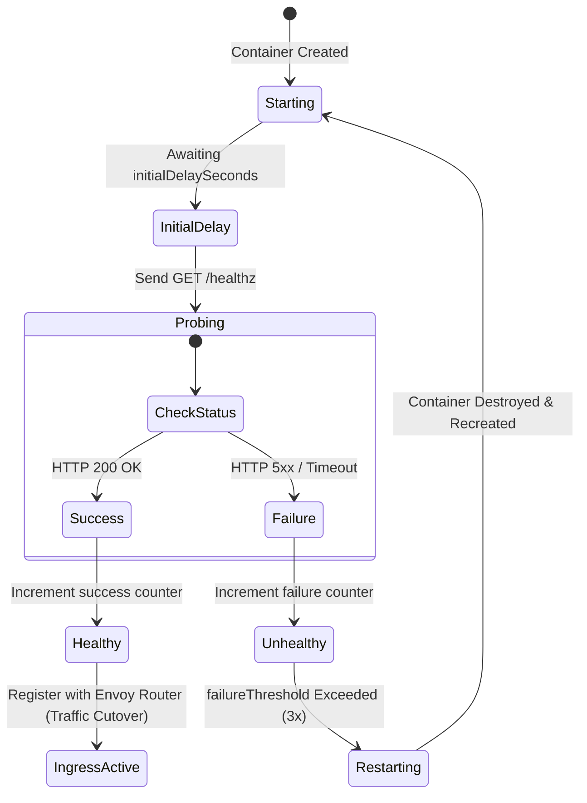

# 03: BACKEND SERVICES SPECIFICATION (RENDER BENCHMARK)

---

## 1. Executive Benchmark & Architectural Comparative Audit

In Whizan 1.0, backend services run as individual Docker containers bound to ephemeral host ports (e.g. `3001..3100`) directly on the Azure VM host (`20.2.136.11`). An in-memory Node.js reverse proxy (`apps/edge-router`) routes traffic based on an internal routing table loaded from Redis.

This setup suffers from critical operational limitations:
1. **Single Point of Failure**: A kernel panic, out-of-memory (OOM) freeze, or host network failure on the VM takes down all running customer backend services simultaneously.
2. **Workload Ambiguity**: The system makes no architectural distinction between an HTTP API and a continuous background consumer (e.g. BullMQ or Celery worker), attempting to probe port 3000 on headless workers and failing health checks.
3. **Hard Termination**: Deployments abruptly execute `docker stop --time 5` or `docker kill`, severing active database connections and dropping in-flight HTTP requests.
4. **Secret Exposure**: Secrets are passed strictly as plaintext environment variables, incompatible with applications expecting SSL certificates or configuration files on disk (`/etc/secrets/*`).

Whizan 2.0 re-architects backend services into a **Multi-Archetype, Elastic Container Platform** matching and surpassing Render's architecture.

```
WHIZAN 1.0 (Single-Host Port Hunting)        WHIZAN 2.0 (Decoupled Elastic Archetypes)
┌──────────────────────────────────────┐     ┌──────────────────────────────────────────────────┐
│ Azure VM 20.2.136.11                 │     │ Global Ingress / Envoy Layer-7 Mesh              │
│ ┌──────────────────────────────────┐ │     └────────┬───────────────────┬─────────────────────┘
│ │ Edge Router (findFreePort)       │ │              │                   │
│ └──────┬──────────┬──────────┬─────┘ │              ▼                   ▼
│        │:3001     │:3002     │:3003  │     ┌─────────────────┐ ┌─────────────────┐
│        ▼          ▼          ▼       │     │ Web Service     │ │ Private Service │
│   ┌─────────┐┌─────────┐┌─────────┐  │     │ (KEDA HTTP Auto)│ │ (Internal Mesh) │
│   │API Svc  ││Worker   ││API Svc 2│  │     └─────────────────┘ └─────────────────┘
│   │(Crashes)││(Wrong)  ││(OOM)    │  │              │                   │
│   └─────────┘└─────────┘└─────────┘  │              ▼                   ▼
└──────────────────────────────────────┘     ┌─────────────────┐ ┌─────────────────┐
                                             │ Queue Worker    │ │ Cron Job        │
                                             │ (KEDA Queue Auto│ │ (Serverless Job)│
                                             └─────────────────┘ └─────────────────┘
```

### Comparative Capabilities Matrix

| Capability | Whizan 1.0 (Status Quo) | Render Enterprise | Whizan 2.0 Benchmark Spec |
| :--- | :--- | :--- | :--- |
| **Workload Types** | Monolithic container only | Web, Private, Worker, Cron | 4 First-Class Workload Archetypes |
| **Port Management** | Unsafe host port hunting (`3000..3100`) | Isolated virtual overlay mesh | Overlay mesh, identical internal container ports (e.g. 8080) |
| **Zero-Docker Build** | Rudimentary Dockerfile injection | Native Cloud Native Buildpacks | Intelligent Zero-Docker Multi-Stage Polyglot Synthesis |
| **Health Checks** | Raw TCP socket connection test | HTTP `/healthz` status code check | Configurable HTTP / Exec / gRPC Liveness & Readiness Probes |
| **Graceful Shutdown** | Brutal 5-second `SIGKILL` | 30s configurable `SIGTERM` drain | 30s–120s Graceful Drain with Active Connection Tracking |
| **Secret Files** | Plaintext ENV strings only | Secret Files (`/etc/secrets/...`) | Encrypted Secret Files mounted into RAM (`tmpfs`) |
| **Zero-Downtime Cutover** | Host port switch in router memory | Rolling blue/green with socket hold | Blue/Green with Envoy Ingress Socket Holding & Drain Window |

---

## 2. The Four First-Class Workload Archetypes

Whizan 2.0 natively classifies and provisions backend infrastructure according to four distinct service archetypes:

```
                            ┌───────────────────────────────────────────────┐
                            │           Whizan Service Archetypes           │
                            └───────┬───────────┬───────────┬───────────┬───┘
                                    │           │           │           │
            ┌───────────────────────┘           │           │           └───────────────────────┐
            ▼                                   ▼           ▼                                   ▼
┌───────────────────────┐   ┌───────────────────────┐   ┌───────────────────────┐   ┌───────────────────────┐
│ 1. Web Service        │   │ 2. Private Service    │   │ 3. Background Worker  │   │ 4. Cron Job           │
│ • Public HTTPS Ingress│   │ • Zero Public Access  │   │ • Headless Daemon     │   │ • Scheduled Ephemeral │
│ • TLS Termination     │   │ • Internal Mesh Only  │   │ • Queue Driven Scaling│   │ • On-Demand Execution │
│ • Scale 0 -> N        │   │ • Database/Cache Svc  │   │ • Liveness via Heart  │   │ • Exit Code Tracking  │
└───────────────────────┘   └───────────────────────┘   └───────────────────────┘   └───────────────────────┘
```

### Archetype 1: Web Service
- **Ingress**: Exposed to the internet via Cloudflare and the Envoy Ingress Gateway at `https://<slug>.whizan.cloud` or custom domains.
- **Autoscaling**: Scaled from 0 to $N$ replicas based on concurrent HTTP requests and request queuing depth.
- **Health Verification**: Deep HTTP readiness probing before routing incoming traffic.

### Archetype 2: Private Service
- **Ingress**: **Zero public exposure**. Rejects all external HTTP traffic.
- **Access**: Accessible exclusively via internal DNS over the private WireGuard/Envoy service mesh (`http://order-db.internal:5432` or `http://auth-cache.internal:6379`).
- **Use Cases**: Internal microservices, internal GraphQL gateways, and Redis/Postgres datastores.

### Archetype 3: Background Queue Worker
- **Ingress**: Headless daemon (`internalPort: 0`).
- **Health Verification**: Process existence and heartbeat files (e.g. `/tmp/worker-heartbeat`) rather than HTTP probes.
- **Autoscaling**: Scaled dynamically using KEDA triggers connected to Redis list length, RabbitMQ queue depth, or Kafka consumer group lag.

### Archetype 4: Scheduled Cron Job
- **Execution Model**: Ephemeral execution. Containers boot on a scheduled cron expression (`0 */2 * * *`), execute the assigned command (e.g. `python process_invoices.py`), report stdout/stderr to the control plane, and terminate immediately upon exit code `0`.
- **Billing**: Compute is charged strictly for the exact seconds consumed during execution.

---

## 3. Zero-Docker Polyglot Multi-Stage Build Synthesis

Whizan 2.0 features an automated container synthesis engine that analyzes source code and generates optimized multi-stage production container images without requiring a user-provided `Dockerfile`.

### Supported Runtimes & Synthesis Logic
1. **Node.js (Next.js, NestJS, Express, Fastify)**:
   - Automated detection of package managers (`pnpm`, `bun`, `yarn`, `npm`).
   - Dedicated build stage generating standalone bundles followed by minimal Alpine runtime stage (`node:20-alpine`).
2. **Python (FastAPI, Flask, Django, Celery)**:
   - Automated detection of `poetry.lock`, `Pipfile.lock`, or `requirements.txt`.
   - Automated compilation of C-extensions (e.g. `gcc`, `musl-dev`, `libpq-dev`) in build stage, copying only clean virtual environments to slim runtime (`python:3.11-slim`).
3. **Go (Golang)**:
   - Multi-stage build with `golang:1.22-alpine` compiling static binary (`CGO_ENABLED=0`), executed inside a scratch or distroless image (`gcr.io/distroless/static`).
4. **Rust**:
   - Cargo build using `cargo-chef` to cache dependencies, generating a stripped static binary.
5. **Java (Spring Boot, Micronaut)**:
   - Gradle / Maven multi-stage build running on `eclipse-temurin:21-jre-alpine`.
6. **Ruby on Rails**:
   - Production asset precompilation and jemalloc memory optimization.
7. **.NET 8 (C# / F#)**:
   - `dotnet publish -c Release -o /app` deployed to `mcr.microsoft.com/dotnet/aspnet:8.0`.

### Example Synthesized Multi-Stage Build for Python FastAPI
```dockerfile
# Stage 1: Build Dependencies & C-Extensions
FROM python:3.11-slim AS builder
WORKDIR /app
RUN apt-get update && apt-get install -y --no-install-recommends \
    build-essential libpq-dev curl && rm -rf /var/lib/apt/lists/*
RUN python -m venv /opt/venv
ENV PATH="/opt/venv/bin:$PATH"
COPY requirements.txt .
RUN pip install --no-cache-dir --upgrade pip && \
    pip install --no-cache-dir -r requirements.txt

# Stage 2: Final Slim Runtime
FROM python:3.11-slim AS runner
WORKDIR /app
RUN apt-get update && apt-get install -y --no-install-recommends \
    libpq5 ca-certificates curl && rm -rf /var/lib/apt/lists/*
COPY --from=builder /opt/venv /opt/venv
ENV PATH="/opt/venv/bin:$PATH"
COPY . .
# Enforce non-root execution for enterprise security
RUN useradd -m -u 1001 whizan && chown -R whizan:whizan /app
USER whizan
ENV PYTHONUNBUFFERED=1
EXPOSE 8080
HEALTHCHECK --interval=10s --timeout=3s --retries=3 \
    CMD curl -f http://127.0.0.1:8080/healthz || exit 1
CMD ["uvicorn", "main:app", "--host", "0.0.0.0", "--port", "8080"]
```

---

## 4. Deep Health Checks & Self-Healing Probes

Whizan 1.0 checked services by attempting a raw TCP socket connection. If a service bound to port 3000 but was locked in a database connection deadlock, the check passed while all user requests failed with 500 errors.

Whizan 2.0 introduces three enterprise probe types configurable in `whizan.json`:

```json
{
  "healthCheck": {
    "type": "HTTP",
    "path": "/api/healthz",
    "expectedStatus": 200,
    "initialDelaySeconds": 5,
    "periodSeconds": 10,
    "timeoutSeconds": 3,
    "failureThreshold": 3
  }
}
```



---

## 5. Graceful Connection Draining & SIGTERM Lifecycle

To guarantee zero dropped requests during rolling deployments and autoscaling scale-down events, Whizan 2.0 implements a strict graceful drainage protocol.

### Termination Sequence
1. **Deregistration**: Ingress gateway removes the container IP from active routing pools. No new connections are routed to this instance.
2. **SIGTERM Broadcast**: The container process receives a `SIGTERM` signal.
3. **Drain Window Activation**: A configurable drain timer begins (default: 30 seconds; max: 120 seconds).
4. **Application Draining**:
   - Active HTTP requests are permitted to complete.
   - Background tasks finish processing current batch items.
   - Database connection pools are closed gracefully.
5. **SIGKILL Contingency**: If the process fails to exit after the configured drain period expires, a `SIGKILL` is issued to release compute resources.

### Node.js Production Graceful Shutdown Handler Pattern
```typescript
import http from 'http';
import { prisma } from './db';

const server = http.createServer((req, res) => {
  res.end('Whizan Cloud 2.0 Web Service');
});

server.listen(8080, '0.0.0.0');

// Graceful Shutdown Listener
process.on('SIGTERM', async () => {
  console.log('Received SIGTERM. Initiating graceful drain window...');
  
  // 1. Stop accepting new connections
  server.close(async () => {
    console.log('HTTP server closed. Draining database connection pools...');
    try {
      await prisma.$disconnect();
      console.log('Database connections closed cleanly.');
      process.exit(0);
    } catch (err) {
      console.error('Error during database teardown:', err);
      process.exit(1);
    }
  });

  // 2. Safety timeout: Force exit if requests hang past 25s
  setTimeout(() => {
    console.error('Forcefully exiting due to drain timeout.');
    process.exit(1);
  }, 25000);
});
```

---

## 6. Shared Environment Groups and Secret Files

### Secret Files Architecture
Certain enterprise frameworks and databases require private keys, certificates, or configuration files rather than environment strings (e.g. `service-account.json`, `tls.crt`, `id_rsa`, `pg_hba.conf`).

Whizan 2.0 introduces **Secret Files**:
1. Stored in encrypted Azure Key Vault / HashiCorp Vault storage.
2. Injected into the container filesystem at runtime as an in-memory `tmpfs` volume mounted at `/etc/secrets/<filename>`.
3. Secret files **never persist to host disk or container images**, eliminating disk leakage risks.

### Shared Environment Groups
Teams can define reusable environment variable collections (e.g. `Stripe Production Keys`, `Shared Database URLs`) and attach them to multiple web services and workers simultaneously. Updating a variable in a Shared Group triggers an automated rolling redeployment across all linked services.
