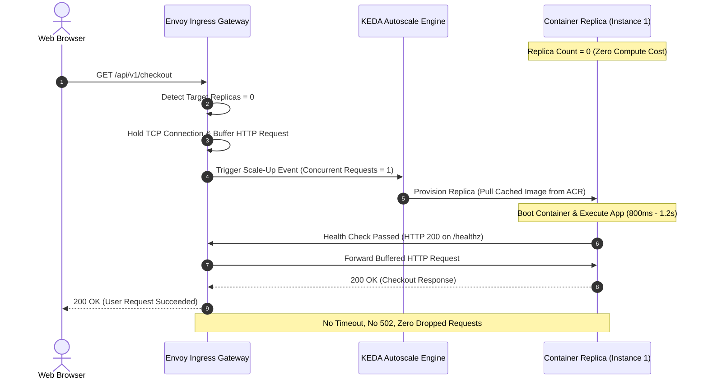

# 04: SERVERLESS CONTAINER ENGINE SPECIFICATION (AZURE ACA & KEDA)

---

## 1. Architectural Overview

The core flaw of Whizan 1.0 is its static compute topology: a single Azure VM (`Standard_B2s`, 2 vCPUs, 4 GB RAM) runs continuously 24/7. Even when customer applications receive zero requests, the host VM incurs costs. Under traffic spikes, the VM exhausts memory and crashes all hosted containers.

Whizan 2.0 replaces the single-VM model with a **Managed Serverless Container Engine** powered by **Azure Container Apps (ACA)**, **KEDA (Kubernetes Event-driven Autoscaling)**, and **Envoy Layer-7 Ingress**.

```
                                  ┌───────────────────────────────┐
                                  │      Cloudflare Edge CDN      │
                                  └───────────────┬───────────────┘
                                                  │
                                                  ▼
                        ┌───────────────────────────────────────────────────┐
                        │    Azure Container Apps Managed Environment       │
                        │                                                   │
                        │  ┌─────────────────────────────────────────────┐  │
                        │  │        Envoy Layer-7 Ingress Gateway        │  │
                        │  │  • TLS Termination     • Path-based Routing │  │
                        │  │  • Connection Holding  • Traffic Splitting  │  │
                        │  └──────┬───────────────────────────────┬──────┘  │
                        │         │                               │         │
                        │         ▼                               ▼         │
                        │  ┌──────────────┐               ┌──────────────┐  │
                        │  │ KEDA Scaler  │               │ KEDA Scaler  │  │
                        │  │ (HTTP Rules) │               │ (Queue Rules)│  │
                        │  └──────┬───────┘               └──────┬───────┘  │
                        │         │                               │         │
                        │         ▼                               ▼         │
                        │  ┌──────────────┐               ┌──────────────┐  │
                        │  │  Replicas    │               │  Replicas    │  │
                        │  │  0 ──► N     │               │  0 ──► N     │  │
                        │  │ (Web Service)│               │ (Worker Svc) │  │
                        │  └──────────────┘               └──────────────┘  │
                        └───────────────────────────────────────────────────┘
```

### Key Architectural Advantages
1. **True Scale-to-Zero ($0.00 Idle Cost)**: When an application receives no incoming requests or queue tasks, its replica count drops to **0**. Both vCPU and RAM allocations are released completely.
2. **Horizontal Elasticity (0 to 100+ Replicas)**: As incoming load spikes, KEDA provisions additional isolated container replicas within seconds.
3. **No Infrastructure Management**: Azure manages the underlying Kubernetes control plane, worker nodes, OS patching, and network routing.

---

## 2. Scale-to-Zero and Sub-Second Cold Boot Lifecycle

The primary barrier to serverless containers is the cold start penalty. In Whizan 1.0, "Eco Mode" shuts down the entire VM, resulting in an unacceptably long 30–50 second cold boot.

Whizan 2.0 achieves **sub-second to 1.5-second cold starts** through three coordinated layers:



### Cold Boot Optimizations
1. **Azure Container Registry (ACR) Artifact Streaming**: Container layers are cached directly on the Azure Container Apps host nodes, reducing image pull times from 8 seconds to **under 400ms**.
2. **Envoy Connection Holding**: Incoming requests arriving during replica scale-up (0 $\rightarrow$ 1) are buffered in Envoy's ingress request queue for up to **15 seconds** rather than returning 502 or 503 errors.
3. **Optimized Multi-Stage Container Footprint**: Base images are restricted to minimal Alpine or distroless runtimes (<80 MB uncompressed).

---

## 3. KEDA Event-Driven Autoscaling Policies

Whizan 2.0 utilizes KEDA to autoscale container replicas based on real-time event triggers rather than simple, delayed CPU/memory averages.

### Trigger Archetype 1: HTTP Concurrency Trigger (Web Services)
Scales replicas based on the number of concurrent in-flight HTTP requests per container.

$$\text{Desired Replicas} = \left\lceil \frac{\text{Total In-Flight Requests}}{\text{Target Concurrent Requests per Replica}} \right\rceil$$

```yaml
scale:
  minReplicas: 0
  maxReplicas: 30
  rules:
    - name: http-concurrency-rule
      type: http
      metadata:
        concurrentRequests: "50"
```
*Example: If an API experiences 450 concurrent connections, KEDA immediately scales the application to $\lceil 450 / 50 \rceil = 9$ container replicas.*

### Trigger Archetype 2: Redis List / Queue Trigger (Workers)
Scales headless background queue consumers based on pending job backlog.

```yaml
scale:
  minReplicas: 0
  maxReplicas: 20
  rules:
    - name: redis-queue-backlog
      type: redis
      metadata:
        address: "redis-cluster.internal:6379"
        listName: "jobs:transcoding"
        listLength: "10"
      auth:
        - secretRef: redis-password
          triggerParameter: password
```
*Example: If 80 video transcoding jobs are queued, KEDA provisions 8 worker containers in parallel.*

### Trigger Archetype 3: Cron Schedule Trigger (Batch Pipelines)
Pre-warms or scales compute ahead of anticipated predictable traffic spikes (e.g. daily 9:00 AM enterprise syncs).

```yaml
scale:
  minReplicas: 1
  maxReplicas: 10
  rules:
    - name: scheduled-morning-rush
      type: cron
      metadata:
        timezone: "UTC"
        start: "0 9 * * 1-5"
        end: "0 18 * * 1-5"
        desiredReplicas: "5"
```

---

## 4. Traffic Splitting, Canaries, and Revisions

Whizan 2.0 leverages Azure Container Apps Revisions to support zero-downtime Blue/Green deployments and progressive canary rollouts without requiring complex service mesh configurations.

```
                           ┌───────────────────────────────┐
                           │   Envoy Ingress Gateway       │
                           └───────┬───────────────┬───────┘
                                   │               │
                         80% Load  │               │ 20% Load
                         (Stable)  │               │ (Canary)
                                   ▼               ▼
                        ┌─────────────────┐ ┌─────────────────┐
                        │ Revision v1.4.0 │ │ Revision v1.5.0 │
                        │ (Old Production)│ │ (New Deployment)│
                        └─────────────────┘ └─────────────────┘
```

### Traffic Splitting Configuration (`arm-appcontainers`)
```json
{
  "ingress": {
    "external": true,
    "targetPort": 8080,
    "traffic": [
      {
        "revisionName": "myapp--v1-4-0",
        "weight": 80,
        "label": "current"
      },
      {
        "revisionName": "myapp--v1-5-0",
        "weight": 20,
        "label": "canary"
      }
    ]
  }
}
```

### Instant Rollback Protocol
If telemetry indicators (e.g. 5xx error rate or p95 latency) exceed defined failure thresholds during a canary deployment:
1. An automated health monitoring hook updates traffic weights to `100% current` and `0% canary` within **sub-second propagation time**.
2. No rebuilds, re-uploads, or container restarts are required.

---

## 5. Programmatic Provisioning Engine Implementation

The Whizan Control Plane (`apps/api`) interacts directly with Azure Resource Manager using the `@azure/arm-appcontainers` SDK to create and manage serverless containers.

### Production Provisioning Service (`apps/api/src/services/container-engine.service.ts`)
```typescript
import { ContainerAppsAPIClient } from "@azure/arm-appcontainers";
import { DefaultAzureCredential } from "@azure/identity";

const subscriptionId = process.env.AZURE_SUBSCRIPTION_ID!;
const resourceGroupName = process.env.AZURE_RESOURCE_GROUP!;
const managedEnvId = process.env.AZURE_MANAGED_ENV_ID!;
const acrServer = process.env.AZURE_ACR_SERVER!;

const client = new ContainerAppsAPIClient(new DefaultAzureCredential(), subscriptionId);

export interface ProvisionServiceOptions {
  serviceId: string;
  slug: string;
  imageTag: string;
  envVars: Array<{ name: string; value: string }>;
  minReplicas?: number;
  maxReplicas?: number;
  cpu?: number;
  memory?: string;
  targetPort?: number;
  isWorker?: boolean;
}

export async function provisionServerlessContainer(opts: ProvisionServiceOptions) {
  const containerAppName = `whz-${opts.slug}`;

  const containerConfig = {
    location: "eastus",
    managedEnvironmentId: managedEnvId,
    configuration: {
      activeRevisionsMode: "Single",
      secrets: opts.envVars.map((e) => ({
        name: e.name.toLowerCase().replace(/_/g, "-"),
        value: e.value,
      })),
      ingress: opts.isWorker
        ? undefined
        : {
            external: true,
            targetPort: opts.targetPort || 8080,
            transport: "auto",
            allowInsecure: false,
          },
    },
    template: {
      containers: [
        {
          name: opts.slug,
          image: `${acrServer}/whizan/${opts.slug}:${opts.imageTag}`,
          resources: {
            cpu: opts.cpu || 0.25,
            memory: opts.memory || "0.5Gi",
          },
          env: opts.envVars.map((e) => ({
            name: e.name,
            secretRef: e.name.toLowerCase().replace(/_/g, "-"),
          })),
          probes: opts.isWorker
            ? []
            : [
                {
                  type: "Liveness",
                  httpGet: {
                    path: "/healthz",
                    port: opts.targetPort || 8080,
                  },
                  initialDelaySeconds: 5,
                  periodSeconds: 10,
                },
              ],
        },
      ],
      scale: {
        minReplicas: opts.minReplicas ?? 0,
        maxReplicas: opts.maxReplicas ?? 10,
        rules: opts.isWorker
          ? []
          : [
              {
                name: "http-scaling-rule",
                http: {
                  metadata: {
                    concurrentRequests: "50",
                  },
                },
              },
            ],
      },
    },
  };

  const poller = await client.containerApps.beginCreateOrUpdate(
    resourceGroupName,
    containerAppName,
    containerConfig
  );

  const result = await poller.pollUntilDone();
  return {
    fqdn: result.configuration?.ingress?.fqdn,
    latestRevisionName: result.latestRevisionName,
    provisioningState: result.provisioningState,
  };
}
```
