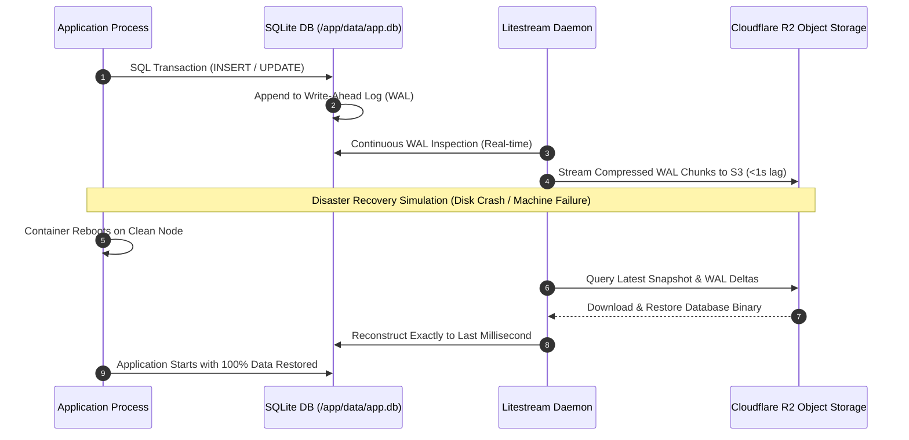
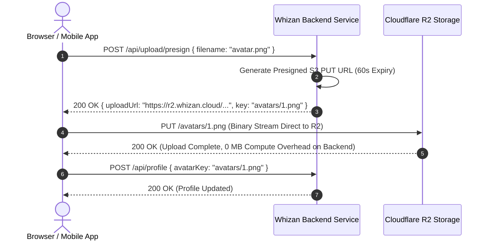

# 07: PERSISTENT STORAGE VOLUMES & DATA RESILIENCE SPECIFICATION

---

## 1. Executive Problem Statement & Architectural Audit

In Whizan 1.0, container filesystems are strictly ephemeral and tied directly to the lifecycle of the container:
- When a user pushes a Git commit, Whizan 1.0 pulls the source code, builds a brand new Docker image, and stops/destroys the previous container.
- **The Data Destruction Bug**: Any data stored inside the container—such as an embedded SQLite database (`prisma.db`, `data.sqlite3`), local user uploads (`/app/uploads`), CMS assets, or machine learning models—is permanently deleted upon redeployment.
- Whizan 1.0 lacks persistent volume mounts, rendering the platform unusable for stateful workloads like Ghost CMS, PocketBase, Strapi, or SQLite-backed production microservices.

Whizan 2.0 introduces **Decoupled Persistent Block Volumes** and **Automated Litestream S3 Disaster Recovery**, separating application state from deployment lifecycles.

```
WHIZAN 1.0 (State Wiped on Deploy)           WHIZAN 2.0 (Persistent Volumes + R2 Sync)
┌──────────────────────────────────────┐     ┌──────────────────────────────────────────────────┐
│ Container v1 (Local Disk)            │     │ Deployment v1 ──► Deployment v2 ──► Deployment v3│
│ ┌──────────────────────────────────┐ │     └────────┬──────────────┬──────────────┬───────────┘
│ │ /app/data/app.db (SQLite)        │ │              │              │              │
│ └──────────────────────────────────┘ │              │ (Decoupled Mount Point /app/data)
│                                      │              ▼              ▼              ▼
│ [REDEPLOYMENT TRIGGERED]             │     ┌──────────────────────────────────────────────────┐
│ Container v1 Destroyed ──► DATA LOST!│     │ Managed Persistent SSD Block Volume              │
│ Container v2 Spun up with Empty Disk │     │ /opt/whizan/volumes/{volumeId}                   │
└──────────────────────────────────────┘     └────────────────────────┬─────────────────────────┘
                                                                      │ Litestream WAL Sync (<1s)
                                                                      ▼
                                                             ┌──────────────────┐
                                                             │ Cloudflare R2    │
                                                             │ (Disaster Backup)│
                                                             └──────────────────┘
```

---

## 2. Decoupled Persistent Volume Abstraction

Whizan 2.0 provides isolated persistent volumes backed by high-performance Azure Managed Disks (Premium SSD v2) or distributed Ceph/NFS block stores.

### Lifecycle Separation
- **Independent Creation**: Volumes exist as independent entities in the Whizan Control Plane, decoupled from any specific Git commit or container hash.
- **Mount Configuration**: Applications mount volumes declaratively in `whizan.json`:

```json
{
  "version": 2,
  "volumes": [
    {
      "name": "sqlite-data",
      "mountPath": "/app/data",
      "sizeGB": 10
    },
    {
      "name": "user-uploads",
      "mountPath": "/app/public/uploads",
      "sizeGB": 50
    }
  ]
}
```

### Blue/Green Handover Protocol
During rolling deployments:
1. Ingress holds incoming write requests momentarily.
2. Volume mount is gracefully unmounted from the draining container following `SIGTERM` completion.
3. Volume is remounted to the incoming container revision within **< 800ms**.
4. Application resumes operations with complete state intact.

---

## 3. SQLite Production Resilience Architecture (Litestream + WAL)

Many modern applications (PocketBase, Keystatic, Ghost, Litestream-backed Rails/Next.js) utilize SQLite for ultra-low latency reads (<10 microseconds) without maintaining a separate database server.

Whizan 2.0 provides a hardened runtime environment for SQLite workloads:



### Mandatory SQLite Engine Guardrails
When a persistent volume is mounted for SQLite, Whizan runtime sidecars automatically enforce optimal SQLite PRAGMA configurations:

```sql
-- 1. Enable Write-Ahead Logging for high concurrency
PRAGMA journal_mode = WAL;

-- 2. Synchronous Normal provides durability with 10x throughput
PRAGMA synchronous = NORMAL;

-- 3. Increase busy timeout to 5000ms to eliminate locked database errors
PRAGMA busy_timeout = 5000;

-- 4. Enable foreign keys enforcement
PRAGMA foreign_keys = ON;

-- 5. Set memory cache size (64MB)
PRAGMA cache_size = -64000;
```

---

## 4. Cloudflare R2 S3-Compatible Object Storage Integration

For binary files, user-uploaded images, documents, and video streaming, applications should not store large blobs on block volumes. Whizan 2.0 integrates directly with **Cloudflare R2 Object Storage**.

### Advantages Over Traditional S3
- **Zero Egress Bandwidth Fees**: Eliminates unpredictable AWS data transfer charges.
- **Global Anycast Edge Caching**: Assets uploaded to R2 are automatically cached globally via Cloudflare CDN.
- **S3 API Compatibility**: Works seamlessly with `@aws-sdk/client-s3`, `boto3`, and standard storage client libraries.

### Direct Browser-to-R2 Presigned Upload Flow


---

## 5. Automated Volume Snapshots & Non-Disruptive Expansion

1. **Incremental Hourly Snapshots**:
   - Automated point-in-time volume snapshots captured hourly and stored across geographically separated object storage.
   - 14-day rolling retention policy with instant rollback capability.
2. **Online Volume Expansion**:
   - Users can resize a volume (e.g. 10 GB $\rightarrow$ 50 GB) directly from the dashboard.
   - Filesystem expansion (`resize2fs` / `xfs_growfs`) executes live in the background without unmounting the volume or restarting the service.
